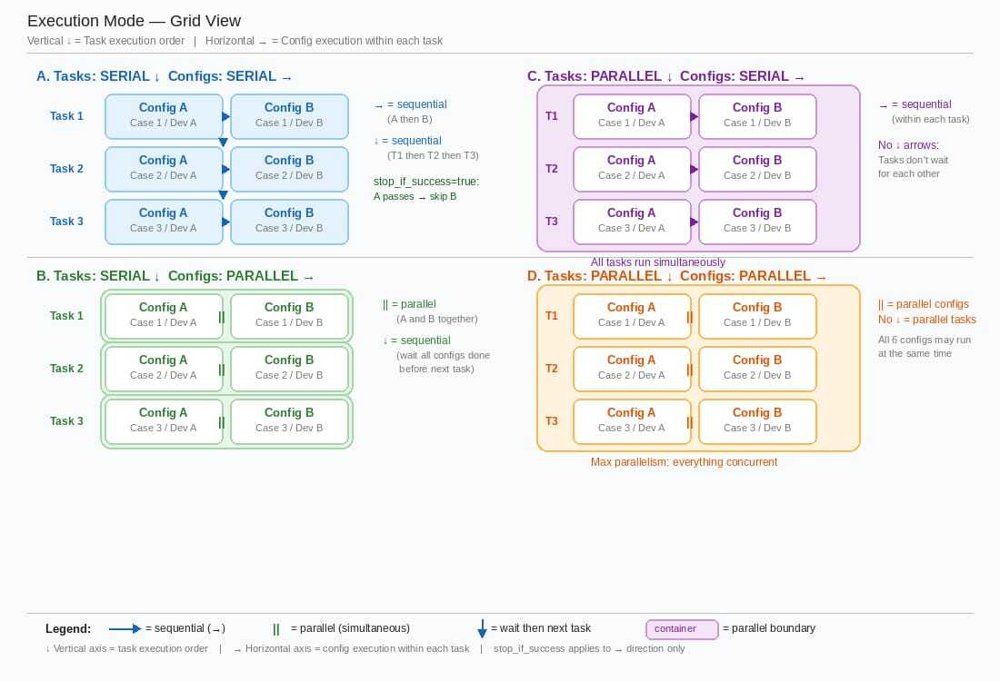
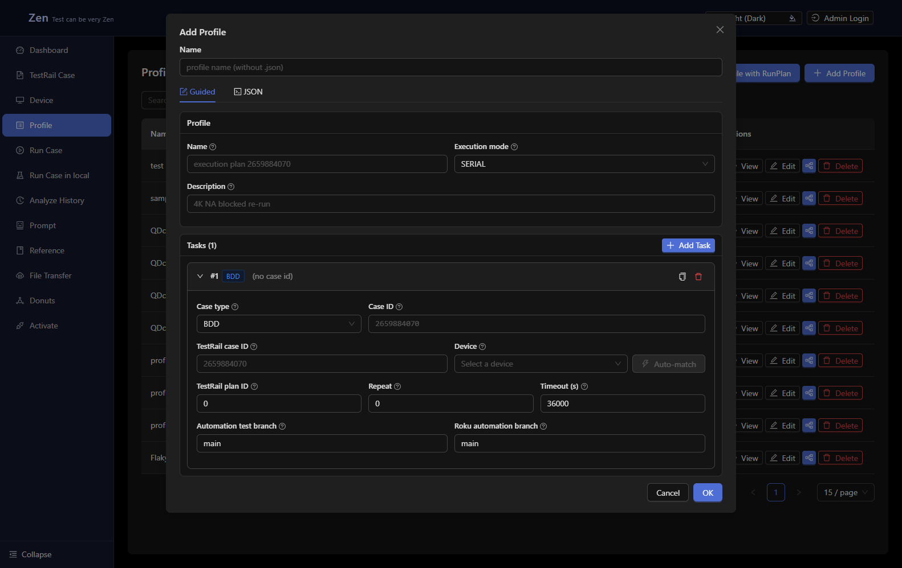
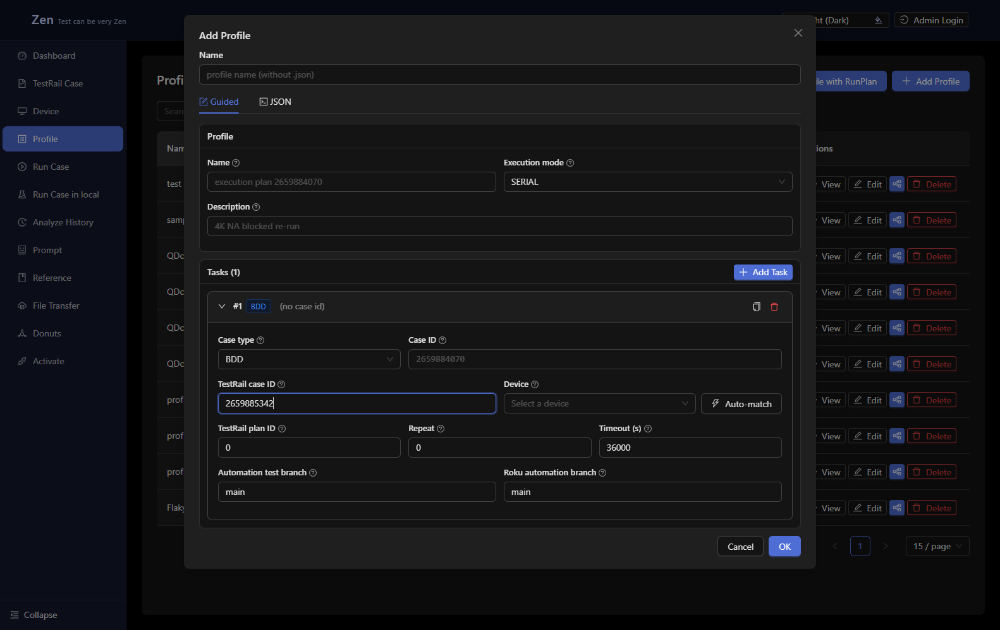
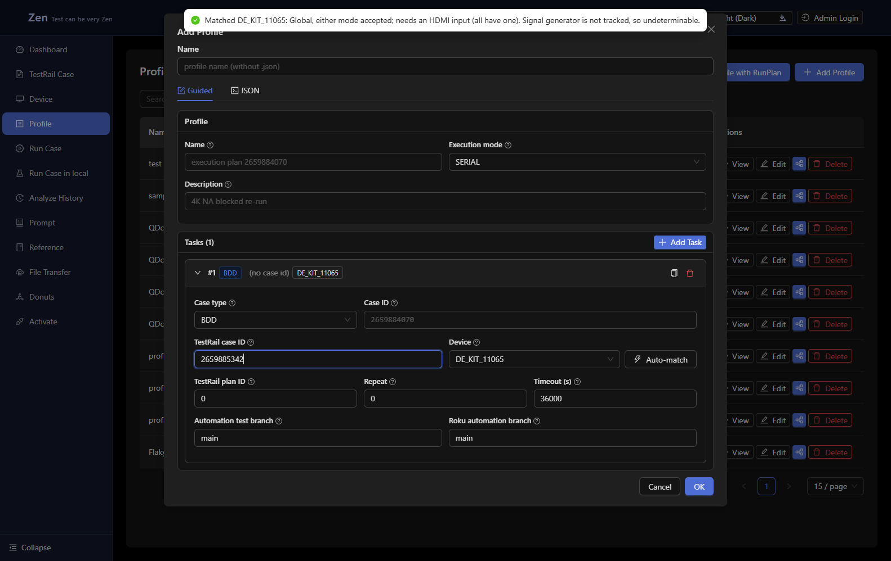
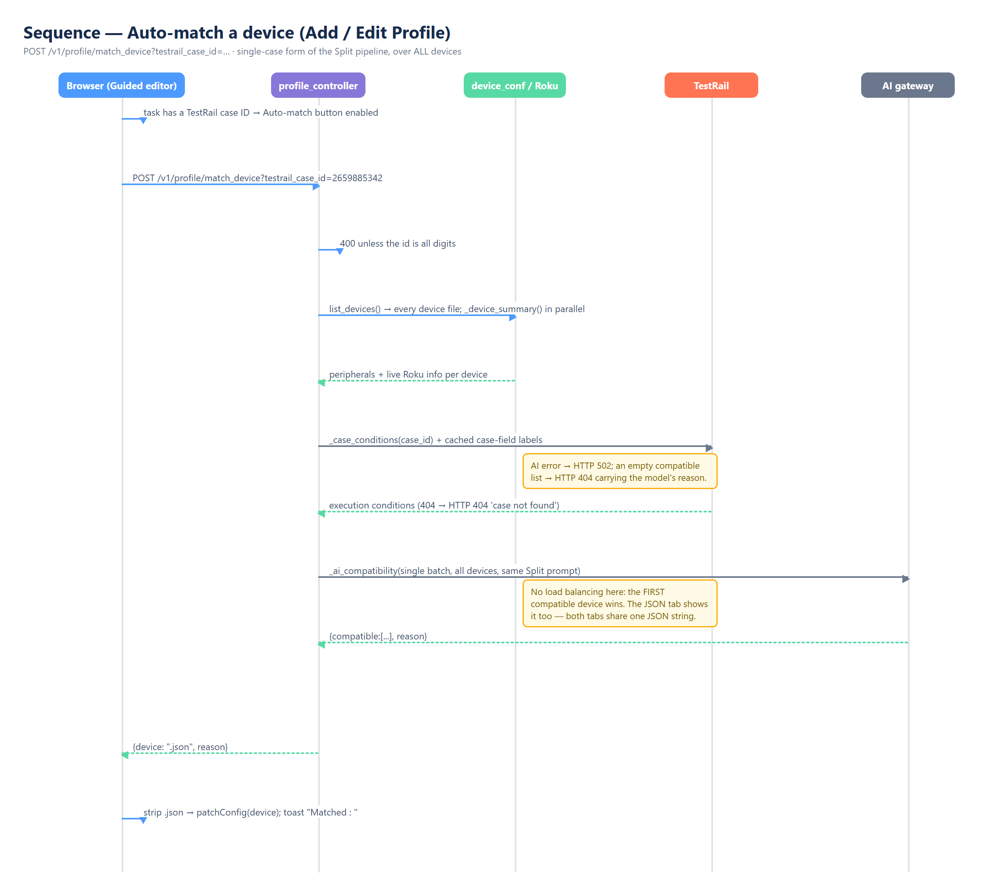
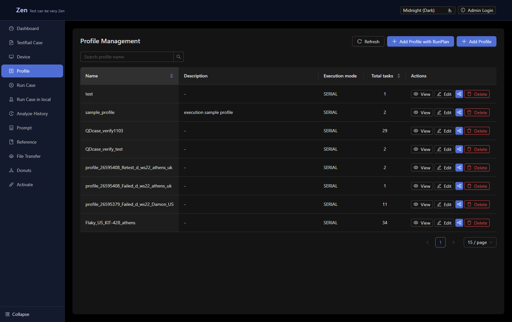
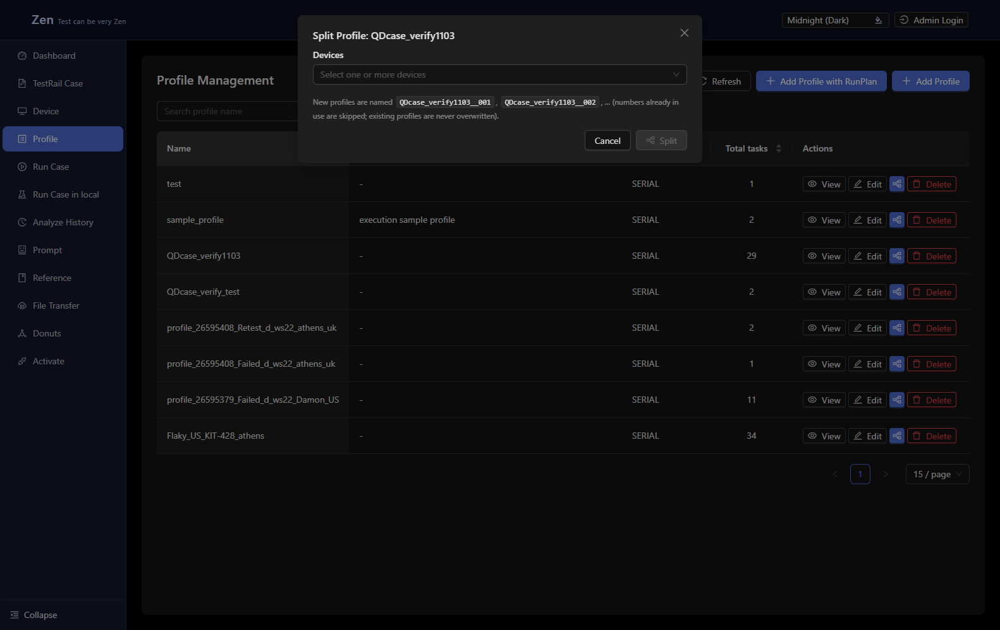
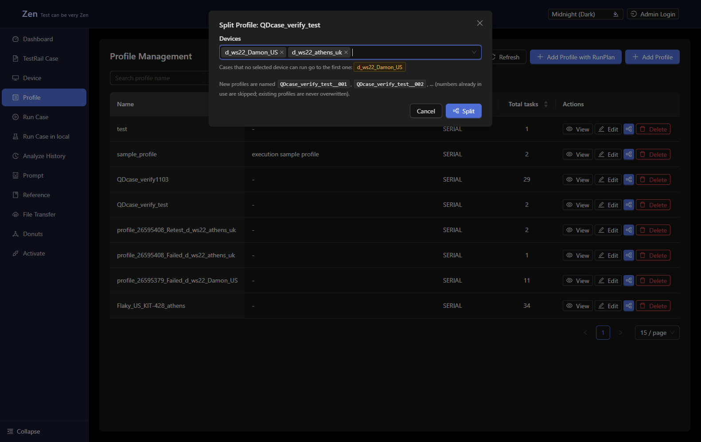
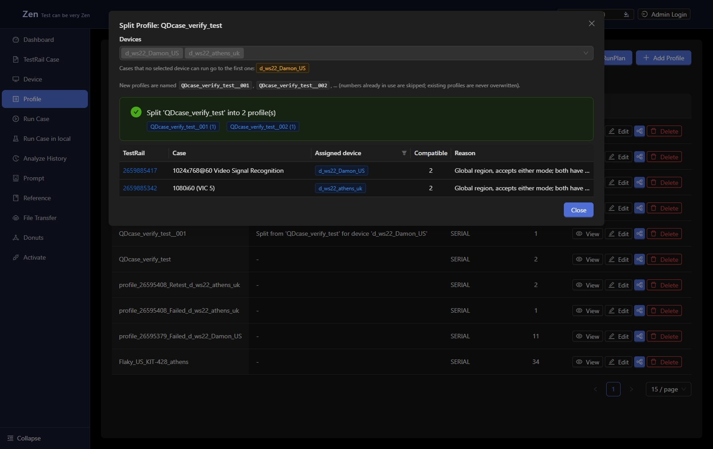
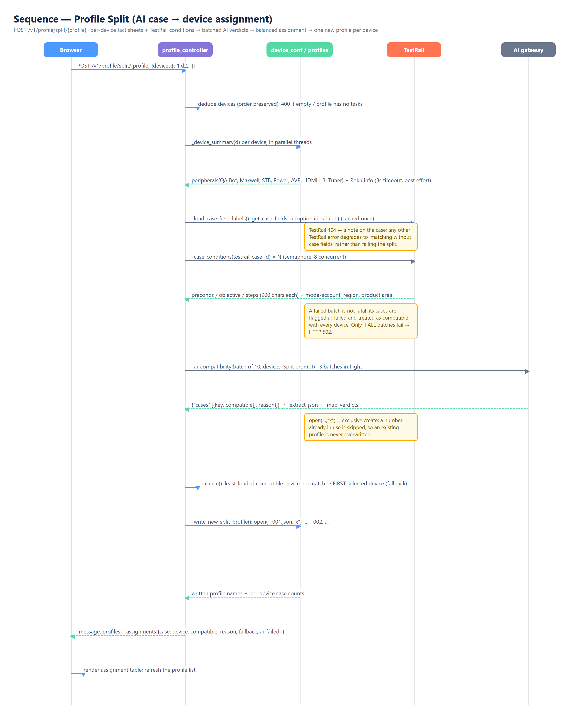

# Zen (QATools)

Web console + runner for Roku QA / test automation: manage device configs, build and
split test profiles, launch cases on QA Hub, AI-analyze failures, run donuts, convert
devices to connected/unconnected mode, and query Roku internal data (JIRA / Confluence /
TestRail / GitLab) with an AI assistant.

| | |
|---|---|
| Frontend | React 18 + TypeScript + Vite + Ant Design v5, port `9898` |
| Backend | FastAPI + Uvicorn, port `9888`, `/v1/*` REST (175 endpoints, 19 controllers) |
| Runner | `4_runcase/test_runner.py`, spawned as a detached process per run |
| Docs | `installation_guide.md` (setup), [Zen User Guide], [Zen Function Spec] |

[Zen User Guide]: https://roku.atlassian.net/wiki/spaces/~7120205ade666fa8a34ecb80f9c50c793056bb/pages/1545109619/Zen+User+Guide
[Zen Function Spec]: https://roku.atlassian.net/wiki/spaces/~7120205ade666fa8a34ecb80f9c50c793056bb/pages/1545011740/Zen+Function+Spec

---

## Quick Start

### Web console (recommended)

```bash
cd $QATOOLS                 # /workspaces/automation-ide/mycode/QATools
./startup_qatools.sh        # backend 9888 + frontend 9898
# open http://<host>:9898/
./restart_qatools.sh        # restart both
./shutdown_qatools.sh       # stop both
```

First-time setup (venv, npm install, `config/env.py`): see `installation_guide.md`.

### CLI runner

```bash
cd $QATOOLS/4_runcase
python3 -u test_runner.py -p <profile> -s All
```

| Flag | Default | Meaning |
|------|---------|---------|
| `-p` / `--profile` | `p2` | Profile name (with or without `.json`) under `4_runcase/profiles/` |
| `-s` / `--select` | `All` | `All`, `Fail`, `Pass`, `Skipped`, `Blocked`, `NA`, `Unknown`, `NoTest` |

Run in background: `nohup python3 -u test_runner.py -p my_profile >> out.log 2>&1 &`
(`-u` disables output buffering).

---

## Layout

| Path | Purpose |
|------|---------|
| `backend/` | FastAPI app (`app.py`), 19 controllers, YAML data stores in `backend/conf/` |
| `frontend/` | React SPA (`src/pages/*`, `src/components/*`, `src/api/client.ts`) |
| `4_runcase/` | Profile-driven QA Hub runner + `profiles/*.json` |
| `5_activate/` | Factory reset + connected / unconnected activation scripts |
| `1_create_test_plan/` | Batch-add cases to TestRail plans (`batch_rerun_cases_to_plan.py`) |
| `config/` | `env.py` (secrets, paths), `device_conf/*.json` (devices), `activate_account.yml` |
| `data/` | Runtime output: run reports, analyzer history, TestRail cache, skills, sessions |
| `docs/` | This README, `images/`, exported User Guide / Function Spec PDFs |

### Ports

| Service | Port | Config |
|---------|------|--------|
| Backend API | `9888` | `backend/conf/config.yml` → `server_config` |
| Frontend dev server | `9898` | `frontend/conf/config.yml` → `server` |
| File Transfer HTTP | `9000` | `backend/conf/file_transfer_data.yml` (started on demand) |

The browser only needs `9898`; Vite proxies `/api/*` to `127.0.0.1:9888`.

---

## Web console tabs

Visibility **and order** are runtime state in `backend/conf/tabs_data.yml`, edited from
**Settings → Tab Settings** (`/v1/config/tabs/*`). `frontend/conf/config.yml` no longer
controls tabs — it only configures the Vite dev server.

| Tab | What it does |
|-----|--------------|
| Dashboard | Landing page; one snapshot card per subsystem (`/v1/dashboard/summary`) |
| Device | CRUD device JSON, QA Hub sync, reserve, download, live `device_info` |
| Profile | CRUD profiles (Guided form + JSON tabs), generate from TestRail, **Split**, **Auto-match** |
| Run Case | Run a profile (optional **Auto analyze**), watch processes/suites, view results |
| Run Case in local | Queue cases per device via the `roku_test` CLI (one at a time per device) with a live log tail |
| Analyze History | Profile analyze reports + per-case AI analyses (Markdown) |
| TestRail Case | Manage plans, search cases by status, cache results |
| Prompt | AI assistant (RAG over JIRA/Confluence/TestRail/GitLab), sessions, Skills |
| Reference | Links + uploaded Markdown docs |
| File Transfer | Browse/upload files, HTTP server, SCP upload, Cmdline + interactive SSH |
| Donuts | Trigger and track donut runs on QA Hub / Jenkins |
| Activate | Factory-reset and convert devices to connected / unconnected mode |
| Settings | Admin-only: tabs, agent/models, Analyze + Split prompts, account, activate accounts |

---

## Profile format

> **Format change.** Each task now carries exactly **one** `config` object (key
> `config`, not a `configs` list). Per-task `execution_mode`, `stop_if_success`
> and `print_console_message` are no longer managed — profiles written through
> the UI drop them and the runner applies its own defaults. `test_source` is
> likewise dropped from configs.

```json
{
    "name": "execution sample profile",
    "description": "execution sample profile",
    "execution_mode": "SERIAL",
    "tasks": [
        {
            "config": {
                "case_type": "BDD",
                "case_id": "2659886400",
                "testrail_case_id": 2659886400,
                "device": "d_de_2",
                "testrail_plan_id": 0,
                "repeat": 0,
                "automation_test_branch": "main",
                "roku_automation_branch": "main"
            },
            "timeout": 36000
        }
    ]
}
```

### Top level

| Key | Type | Default | Description |
|-----|------|---------|-------------|
| `name` | string | — | Plan name (logging only) |
| `description` | string | `""` | Free text; shown in the Profile table |
| `execution_mode` | string | `"SERIAL"` | `"SERIAL"` = one task at a time, `"PARALLEL"` = all tasks concurrently |
| `tasks` | array | `[]` | Task objects |

### Task (`tasks[]`)

| Key | Type | Default | Description |
|-----|------|---------|-------------|
| `config` | object | — | The single case/device config for this task |
| `timeout` | int | `36000` | Max tracking seconds (10 h) |

### Config (`tasks[].config`)

| Key | Type | Default | Description |
|-----|------|---------|-------------|
| `case_type` | string | — | `"BDD"` (Behave), `"UT"` (unit test), `"NEW"` |
| `case_id` | string | — | BDD: numeric TestRail id without the `bdd-` prefix. UT/NEW: `"TestClass.test_method"` |
| `testrail_case_id` | int \| string | `""` | TestRail case id — used for result upload, AI analysis naming, and **Split / Auto-match** |
| `device` | string | — | Device file name in `config/device_conf/` (no `.json`) |
| `testrail_plan_id` | int | `0` | `0` = do not push results; otherwise a plan id |
| `repeat` | int | `0` | Extra repeats (`2` = 3 runs total) |
| `automation_test_branch` | string | `"main"` | `automated_tests` branch |
| `roku_automation_branch` | string | `"main"` | `roku_automation` branch |

Runner-side defaults still honoured if present in hand-written profiles:
`stop_if_success` (default `true`) and `test_source` (default `"file-system"`).

### Execution modes



| `execution_mode` | Behaviour |
|------------------|-----------|
| `SERIAL` | Tasks run one after another; each one is tracked to completion first |
| `PARALLEL` | Every task is launched on its own thread and tracked concurrently |

### Task statuses

`Pending`, `Processing`, `Setup`, `Queued`, `Running`, `Pass`, `Failed`,
`Blocked`, `Skipped`, `NA`, `Unknown`, `Aborted`.

A `Queued` suite is terminated and retried up to 3 times (60 s apart); the suite is
polled every 10 s.

---

## Guided profile editor

Profile **Add / Edit / View** opens two tabs over the *same* JSON text, so switching
never loses edits:

- **Guided** (default) — profile `name` / `description` / `execution_mode`, then one
  collapsible card per task (case type, case id, TestRail case id, device, plan id,
  repeat, both branches, timeout) with duplicate / remove actions and **Add Task**.
  Every field carries a hover hint with an example value.
- **JSON** — raw editor with syntax highlighting and per-key hover docs; invalid JSON
  blocks Save.

The guided tab normalizes defaults into the JSON (what you see is what gets saved) and
preserves any key it does not manage.



---

## Auto-match (Add / Edit Profile)

Picking a device by hand means checking region, linked/unlinked mode and wired-up
peripherals for every case. **Auto-match** does it from the TestRail case ID.

**Where:** Guided tab → expand a task → the button right of the **Device** dropdown.
It stays **disabled until the task has a TestRail case ID** (the automation `case_id`
is not used for matching).



**How:** enter the TestRail case ID → click **Auto-match** → the Device dropdown is
filled in and a toast explains why.



```
POST /v1/profile/match_device?testrail_case_id=2659885342
  → { "device": "DE_KIT_11065.json",
      "reason": "Global, either mode accepted; needs an HDMI input (all have one)." }
```

### What it compares

| Case side (TestRail) | Device side |
|----------------------|-------------|
| `custom_preconds`, `custom_testobjective`, `custom_steps` (900 chars each) | peripherals: QA Bot, Maxwell, STB, Power, AVR, HDMI 1-3, tuner input |
| `custom_mode_account_status` (Connected / Unconnected) | live Roku info: Account Type (region), Linked, Connection Type |
| `custom_region`, `custom_product_area`, `custom_functionality` | Form Factor, 4K, Supported Tuner Types, … |

### Good to know

| Behaviour | Implication |
|-----------|-------------|
| **First compatible device wins** | No load balancing — matching ten tasks can land them all on one device. Use **Split** afterwards to spread them. |
| **Searches every device** | Candidates are all device files, including busy/offline ones. |
| **JSON tab updates too** | Both tabs share one JSON document. |
| **Nothing overwritten on failure** | No match / unknown case / AI error → red toast, Device field untouched. |

| Error | Cause |
|-------|-------|
| `TestRail case '…' not found` | HTTP 404 — the id does not exist |
| `No compatible device…` | HTTP 404 — nothing met the conditions; the reason is in the message |
| `AI analysis failed…` | HTTP 502 — AI gateway unreachable; retry |

### Sequence



---

## Profile Split

A 30-case profile takes hours on one device. **Split** cuts it into one profile per
device so they can run in parallel — and the cases are not dealt out blindly: Zen asks
the AI which of the selected devices can actually *run* each case, then balances them.

### 1. Open the dialog

Each Profile row has a **Split** action (the ⑂ icon, between *Edit* and *Delete*).





### 2. Pick the devices

Select **two or more** devices (the list is searchable).



> ⚠️ **Selection order matters.** Any case that *no* selected device can run is placed
> on the **first device you picked** — the dialog states this under the selector. Put
> your most capable / most general device first.

### 3. Run it

Click **Split**. An *"Analyzing cases…"* banner shows while Zen fetches TestRail
conditions and asks the AI. Cases go out in batches of 10, so a large profile takes a
minute or two — leave the dialog open.

### 4. Read the result



| Column | Meaning |
|--------|---------|
| **TestRail** | Case id, linked to TestRail |
| **Case** | Case title (hover for the automation id) |
| **Assigned device** | Where it landed; filterable. Tags: **fallback** (no device met the conditions → first device), **AI failed** (batch errored → treated as compatible with everything) |
| **Compatible** | How many selected devices qualified (hover for names) |
| **Reason** | The model's short justification |

The profile list behind the dialog has already refreshed with the new
`<profile>__001` / `__002` entries, described as
*"Split from '<profile>' for device '<device>'"*. Close, then run them from Run Case.

### How assignment works

1. **Device fact sheets** — peripherals from `device_conf` + live Roku info
   (8 s timeout, best effort).
2. **Case conditions** — fetched from TestRail, 8 concurrent reads, dropdown ids
   resolved to labels via a cached `get_case_fields`.
3. **AI verdicts** — batches of 10, 3 requests in flight, using the configurable Split
   prompt; the model returns only `{"cases":[{key, compatible[], reason}]}`.
4. **Balance** — most-constrained cases first, each to the least-loaded *compatible*
   device; no match → first selected device.
5. **Write** — `open(path, "x")` (exclusive create), so numbers already in use are
   skipped and existing profiles are **never** overwritten.

### Good to know

- The **original profile is never modified** — Split only creates new files.
- Splitting the same profile twice yields `__003`, `__004`, … Delete old ones yourself.
- A device that received no cases gets **no** profile.
- Load is balanced only *among compatible devices*, so counts stay as even as the
  constraints allow.
- TestRail unreachable → matching degrades to the device side alone; one failed AI batch
  → those cases flagged `ai_failed`; **all** batches failing → HTTP 502.

### Sequence



### API

```
POST /v1/profile/split/{profile_name}
Body: { "devices": ["d_ws22_Damon_US", "d_ws22_athens_uk"] }

{
  "message": "Split 'QDcase_verify_test' into 2 profile(s)",
  "profiles": [
    {"device": "d_ws22_Damon_US",  "profile": "QDcase_verify_test__001", "count": 1},
    {"device": "d_ws22_athens_uk", "profile": "QDcase_verify_test__002", "count": 1}
  ],
  "assignments": [
    {
      "case_id": "2659885417",
      "testrail_case_id": 2659885417,
      "title": "1024x768@60 Video Signal Recognition",
      "device": "d_ws22_Damon_US",
      "compatible": ["d_ws22_Damon_US", "d_ws22_athens_uk"],
      "reason": "Global region, accepts either mode; both have HDMI inputs.",
      "fallback": false,
      "ai_failed": false
    }
  ]
}
```

### Tuning the prompt

Both Split and Auto-match use the same template, editable in
**Settings → Split Profile Prompt** (`analyze_data.yml` →
`analyze_config.split_prompt_template`):

| | |
|---|---|
| Required placeholders | `{devices}` and `{cases}` — Save is blocked while either is missing |
| Reset | **Reset to Default** restores the built-in `DEFAULT_SPLIT_PROMPT` |
| Applies | On the next split / match; no restart |
| Safety | A stored template that later loses a placeholder is ignored in favour of the built-in default |

Internal constants (`profile_controller.py`): `_AI_BATCH_SIZE=10`,
`_AI_CONCURRENCY=3`, `_TESTRAIL_CONCURRENCY=8`, `_TESTRAIL_TIMEOUT=8`,
`_DEVICE_INFO_TIMEOUT=8`, `_CASE_TEXT_LIMIT=900`.

---

## Generate from TestRail

**Add Profile with RunPlan** turns a cached TestRail result set into a profile:
pick plan + status + device → `profile_<plan>_<status>_<device>.json`, one task per case
that has an `automation_id` (`bdd-` prefix → `BDD`, otherwise `UT`). Cache a plan+status
first by searching it in the TestRail Case tab.

---

## Run & analyze

`POST /v1/runcase/run` spawns `python3 -u test_runner.py -p <profile> -s <select>`
detached and returns its PID. Output lands in `data/runcase_report/`:

- `<ts>_<profile>.cache` — live task results + `task_progress`
- `<ts>_<profile>_summary_report.txt` — JSON summary (`case_ids`, `testrail_case_ids`,
  `status`, `log_url`, `build_number`)

### Auto analyze

Tick **Auto analyze** in Run Case (or call `POST /v1/runcase/analyze_profile` for the
latest run of a profile). After the run finishes Zen analyzes every **non-passing** case:

- per case → `data/analyzer_history/<testrail_case_id>__<profile>__<case_id>__<result>__<locale>__<datetime>.md`
- per profile → `p__<profile>__<nopass>__<total>__<locale>__<datetime>.yml`

The profile report is published immediately with `status: analyzing` and rewritten after
every case, so **Analyze History → Profile Analyze Reports** shows `Analyzing n/m` and
then links to each case report. The default locale and the analyze prompt live in
**Settings → Agent Settings** (`analyze_data.yml`; default locale is `en-US`).

---

## Device config

Files in `config/device_conf/`; the file name (minus `.json`) is the device key.

```json
{
    "roku": {
        "device_id": "S27F762DCXCP",
        "serial_number": "X032000DCXCP",
        "brand_name": "TCL",
        "ip_address": "10.64.22.68",
        "maxwell_config": { "host": "10.64.29.240" },
        "power_config": { "host": "10.64.16.20", "model": "TP_LINK_HS300", "outlet": 3 },
        "qa_bot_config": { "host": "10.64.16.146" },
        "avr_info_config": { "ip_address": "10.64.24.243" },
        "display_power_config": { "host": "10.64.16.20", "model": "TP_LINK_HS300", "outlet": 4 }
    }
}
```

| Field (under `roku`) | Required | Description |
|----------------------|----------|-------------|
| `serial_number` | Yes | Device ESN |
| `device_id` | Yes | Device ID |
| `ip_address` | Yes | Device IP |
| `brand_name` | Yes | TV brand |
| `maxwell_config.host` | No | Maxwell tuner simulator IP |
| `power_config` | No | Power strip: `host`, `outlet`, `model` (`RTVSP_POWER_SWITCH`, `90_240VAC_SMART_PDU`, `TP_LINK_HS300`) |
| `display_power_config` | No | Second outlet controlling the display |
| `qa_bot_config.host` | No | QA Bot (Raspberry Pi) IP |
| `avr_info_config.ip_address` | No | AVR under test |
| `rtvsp_config` | No | IR blaster: `host`, `port` |
| `serial_config` | No | Serial console: `host`, `serial_port`, `model`, `baudrate` |
| `devices_config` | No | `"HDMI 1"` / `"HDMI 2"` / `"HDMI 3"` → `{ "device_type": "ROKU", ... }` |
| `tuner_input_config` | No | Tuner/RF input wiring |

These sub-sections drive the Device table columns and are exactly what Split and
Auto-match reason over, so keep them accurate.

---

## TestRail plan IDs

| Plan | EU | Global | LATAM | NA | AU |
|------|-----|--------|-------|-----|-----|
| EPG HUD | `24529569` | `24529568` | `24529572` | `24529571` | `24529575` |
| Live TV Pause | `25168259` | `25168234` | `25168248` | `25168244` | — |

Use `0` for no TestRail upload. Plans you work with day-to-day are better managed in the
TestRail Case tab (`backend/conf/testrail.yml`).

---

## Configuration files

| File | Contents |
|------|----------|
| `config/env.py` | Tokens (QA Hub, TestRail, JIRA), data dirs, repo paths. **Git-ignored**; copy from `env.py.example`. Editable via Settings → Environment Settings (restart required) |
| `backend/conf/config.yml` | Backend host/port + the names of the data files below |
| `backend/conf/tabs_data.yml` | Tab visibility and order |
| `backend/conf/agent_data.yml` | AI models, credentials, active model |
| `backend/conf/analyze_data.yml` | Default locale, analyze prompt, **split prompt** |
| `backend/conf/runcase_data.yml` | Run Case user query list, Run-in-local input history |
| `backend/conf/file_transfer_data.yml` | File-transfer root, HTTP port, SCP + cmd caches |
| `backend/conf/testrail.yml` | Saved TestRail plans |
| `backend/conf/ref.yml` | Reference links + uploaded docs |
| `backend/conf/user.yml` | Admin users (bcrypt) |
| `frontend/conf/config.yml` | Vite dev-server host/port (tabs are **not** here anymore) |

---

## API at a glance

All routes under `/v1`; interactive docs at `http://<host>:9888/docs`.

| Base | Controller | Notes |
|------|-----------|-------|
| `/v1/device` | Device | `list`, `list_details`, `download`, `device_info`, `sync_with_qa_hub`, `reservations` |
| `/v1/profile` | Profile | `list_details`, `generate_with_testrail_data`, **`split/{name}`**, **`match_device`** |
| `/v1/runcase` | Run Case | `run` (`auto_analyze`), `analyze_profile`, cache/report files, QA Hub suites, `user_query_list` |
| `/v1/rokutest` | Roku Test | `run` (enqueue), `queues` (per-device, move/clear), `jobs`, `cache/{field}`, log list/view/download/delete |
| `/v1/branch/automated_tests` | Branch | `list`, `current`, `checkout` |
| `/v1/testrail` | TestRail | statuses, plans, `plan/case/list`, `plan/case/add`, cached data |
| `/v1/agent`, `/v1/session`, `/v1/skill` | AI | chat, analyze, search, model switch, sessions, skills (`export/all`) |
| `/v1/analyze_history` | Analyze History | case `.md` list/view/delete + `profile/*` roll-up reports |
| `/v1/config`, `/v1/user` | Config | admin login, tabs, models, agent/analyze/**split** prompts, account, backend restart |
| `/v1/dashboard` | Dashboard | `summary`, `card/{name}` |
| `/v1/donut` | Donut | products, branches, configuration, run, runs, suites, abort, summary, results |
| `/v1/activate`, `/v1/activate_account` | Activate | precheck, start, jobs, logs, per-country accounts |
| `/v1/file_transfer`, `/v1/cmd` | Transfer / Cmd | tree, upload, HTTP server, SCP jobs, script run, interactive SSH |

---

## Skills

Skills are stored as `data/skill_data/<name>/SKILL.md` — the same layout Claude Code
uses, so a skill folder can be copied either way with no conversion.
`GET /v1/skill/export/all` downloads the whole directory as a zip.
