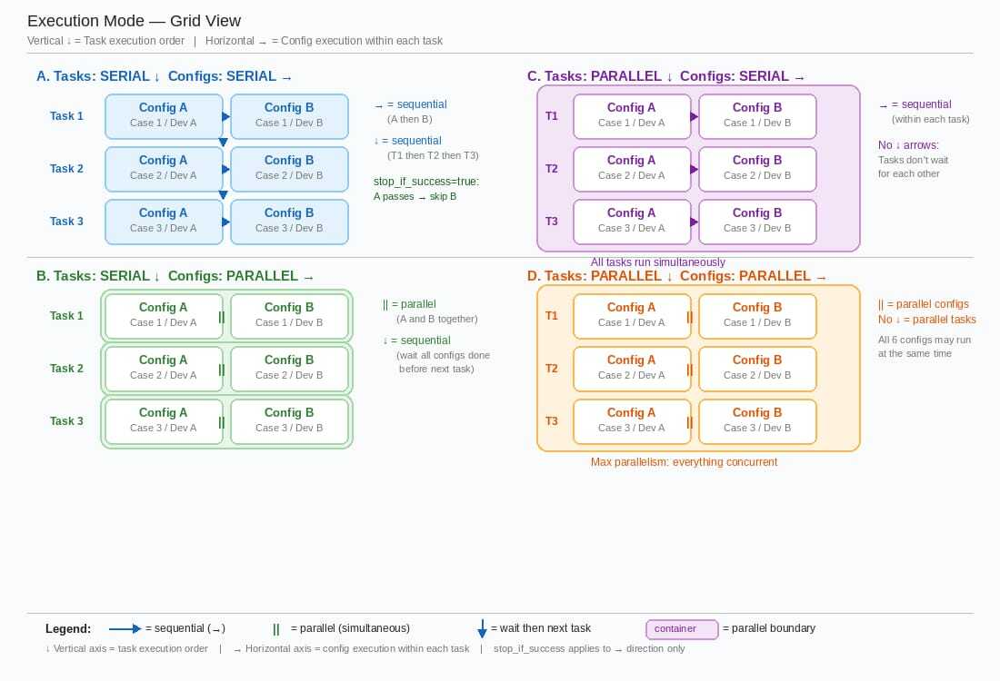

# QA Tools

Automation utilities for Roku QA — run test cases via QA Hub, manage TestRail plans, factory reset devices, and register power mappings.

---

## Quick Start

```bash
cd qatools/4_runcase
# Edit a profile JSON, then:
python test_runner.py
```

---

## Modules

| Module | Purpose | Entry Point |
|--------|---------|-------------|
| `1_create_test_plan` | Batch-add cases to TestRail plans | `batch_rerun_cases_to_plan.py` |
| `4_runcase` | Run automation cases via QA Hub | `test_runner.py` |
| `5_activate` | Factory reset + account activation | `factory_reset_and_activate.py` |
| `80_tools` | Register QA Hub power strip mapping | `register_qahub_power_mapping.py` |

---

## 4_runcase — Test Runner

### Two Ways to Run

**1. Profile mode** (recommended):
```python
# In test_runner.py
create_execution_with_profile("p2659886400").execute()
```

**2. Direct mode** (in code):
```python
TaskExecution(
    tasks=[QAHubTask(configs=[config], execution_mode="SERIAL", stop_if_success=True, timeout=36000)],
    execution_mode="SERIAL"
).execute()
```

### Profile JSON Structure

```json
{
    "name": "my plan",
    "execution_mode": "SERIAL",
    "tasks": [
        {
            "configs": [
                {
                    "case_type": "BDD",
                    "case_id": "2659886400",
                    "device": "d_de_2",
                    "testrail_plan_id": 0,
                    "repeat": 0,
                    "automation_test_branch": "main",
                    "roku_automation_branch": "main"
                }
            ],
            "execution_mode": "PARALLEL",
            "stop_if_success": true,
            "print_console_message": false,
            "timeout": 36000
        }
    ]
}
```

### Profile Parameters

#### Top-level

| Parameter | Type | Default | Description |
|-----------|------|---------|-------------|
| `name` | string | — | Plan name (for logging) |
| `execution_mode` | string | `"SERIAL"` | `"SERIAL"` or `"PARALLEL"` — how tasks are ordered |

#### Task-level (`tasks[]`)

| Parameter | Type | Default | Description |
|-----------|------|---------|-------------|
| `execution_mode` | string | `"SERIAL"` | `"SERIAL"` or `"PARALLEL"` — how configs run within this task |
| `stop_if_success` | bool | `false` | Stop remaining configs after first PASS |
| `print_console_message` | bool | `false` | Print full Jenkins console output |
| `timeout` | int | `36000` | Max wait seconds (default 10h) |

#### Config-level (`tasks[].configs[]`)

| Parameter | Type | Default | Values | Description |
|-----------|------|---------|--------|-------------|
| `case_type` | string | — | `"BDD"`, `"UT"`, `"NEW"` | BDD=Behave, UT=UnitTest, NEW=new automated case |
| `case_id` | string | — | `"2659886400"` or `"TestClass.test_method"` | TestRail ID (BDD/NEW) or test method name (UT) |
| `device` | string | — | `"d_de_2"`, `"d_uk_2_c"`, `"d_us_428"`, `"d_au_r_c_42_140"`, `"d_br_r_c_20_2_4"`, `"d_br_r_c_22_1_4"` | Device config file name (without `.json`) |
| `testrail_plan_id` | int | `0` | `0`=no push, or plan ID like `25168234` | Push results to TestRail plan |
| `repeat` | int | `0` | `0`=once, `2`=3 times total | Additional repeat count |
| `automation_test_branch` | string | `"main"` | any branch | `automated_tests` repo branch |
| `roku_automation_branch` | string | `"main"` | any branch | `roku_automation` repo branch |
| `test_source` | string | `"file-system"` | `"file-system"`, `"testrail"` | Single case or full plan |

### Execution Modes



- **Tasks SERIAL + Configs SERIAL**: Run one task at a time; within each task, run configs one by one. `stop_if_success=true` skips remaining configs on first PASS.
- **Tasks SERIAL + Configs PARALLEL**: Run one task at a time; within each task, all configs run concurrently.
- **Tasks PARALLEL + Configs SERIAL**: All tasks run concurrently; within each, configs run sequentially.
- **Tasks PARALLEL + Configs PARALLEL**: Maximum concurrency — everything runs at once.

### Available TestRail Plan IDs

| Plan | EU | Global | LATAM | NA | AU |
|------|-----|--------|-------|-----|-----|
| EPG HUD | `24529569` | `24529568` | `24529572` | `24529571` | `24529575` |
| Live TV Pause | `25168259` | `25168234` | `25168248` | `25168244` | — |

Use `0` for no TestRail integration.

---

## Device Config

Device JSON files in `config/device_conf/`. File name = device key used in profiles.

### Minimal config

```json
{
    "roku": {
        "brand_name": "QBell",
        "device_id": "S0XNH2DXA37H",
        "serial_number": "X020008XA37H",
        "ip_address": "10.64.39.137",
        "maxwell_config": { "host": "10.64.29.240" }
    }
}
```

### Full config (with power, serial, QA bot)

```json
{
    "roku": {
        "brand_name": "Philco",
        "device_id": "S03M3009U5DL",
        "serial_number": "X00000P9U5DL",
        "ip_address": "10.64.55.149",
        "maxwell_config": { "host": "10.64.29.240" },
        "power_config": { "host": "10.64.55.159", "outlet": 4, "model": "RTVSP_POWER_SWITCH" },
        "qa_bot_config": { "host": "10.64.55.158" },
        "rtvsp_config": { "host": "10.64.55.158", "port": 1 },
        "serial_config": { "host": "10.64.55.158", "serial_port": 1, "model": "5", "baudrate": 115200 }
    }
}
```

### Device Config Fields

| Field | Required | Description |
|-------|----------|-------------|
| `roku.serial_number` | Yes | Device ESN |
| `roku.device_id` | Yes | Device ID |
| `roku.ip_address` | Yes | Device IP |
| `roku.brand_name` | Yes | TV brand |
| `roku.maxwell_config.host` | No | Maxwell tuner simulator IP |
| `roku.power_config` | No | Power strip: `host`, `outlet`, `model` (`RTVSP_POWER_SWITCH` or `90_240VAC_SMART_PDU`) |
| `roku.qa_bot_config.host` | No | QA Bot (RPi) IP |
| `roku.rtvsp_config` | No | IR blaster: `host`, `port` |
| `roku.serial_config` | No | Serial console: `host`, `serial_port`, `model`, `baudrate` |

### Naming convention

`d_<region>_<identifier>.json` — e.g. `d_us_428`, `d_de_2`, `d_uk_2_c`, `d_au_r_c_42_140`

---

## Examples

### Run a single BDD case
```json
{
    "name": "single case",
    "execution_mode": "SERIAL",
    "tasks": [{
        "configs": [{
            "case_type": "BDD",
            "case_id": "2659886400",
            "device": "d_de_2"
        }],
        "execution_mode": "SERIAL",
        "stop_if_success": true,
        "timeout": 36000
    }]
}
```

### Run one case on two devices with failover
```json
{
    "name": "failover",
    "execution_mode": "SERIAL",
    "tasks": [{
        "configs": [
            { "case_type": "BDD", "case_id": "2910861311", "device": "d_de_2", "repeat": 2 },
            { "case_type": "BDD", "case_id": "2910861311", "device": "d_us_428", "repeat": 2 }
        ],
        "execution_mode": "SERIAL",
        "stop_if_success": true,
        "timeout": 36000
    }]
}
```
Tries DE 3 times → if all fail → tries US 3 times. Stops on first PASS.

### Run with TestRail result push
```json
{
    "case_type": "BDD",
    "case_id": "2659886400",
    "device": "d_de_2",
    "testrail_plan_id": 25168234
}
```

### Run in background
```bash
nohup python -u test_runner.py >> output.log 2>&1 &
tail -f output.log
```
Use `-u` to disable Python output buffering.
